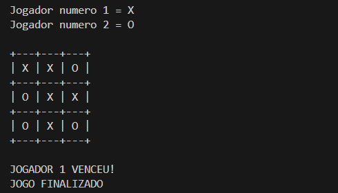

# Jogo da Velha
Este projeto foi a publicação do meu primeiro repositório pessoal! Desenvolvi a versão original no Visualg um tempo atrás e agora passei toda a estrutura para a linguagem C, no qual considero uma boa linguagem para práticar e entender a lógica na programação. O objetivo principal foi consolidar meus conhecimentos e dar o primeiro passo no versionamento de código com Git e GitHub.

## Conceitos Aplicados

* Matrizes bidimensionais para o tabuleiro
* Cálculo matemático de coordenadas (`/` e `%`) para converter posições de 1 a 9
* Estrutura de repetição `do-while` para o ciclo principal de jogo
* Validação de jogadas e verificação de condições de vitória/empate
* Limpeza do terminal com `system("cls")`

## Pré-requisitos

* Compilador **GCC** instalado (ou qualquer outro compilador C)
* Terminal (PowerShell, Command Prompt ou Git Bash)
* Editor de sua preferência

### Exemplo via Terminal (GCC):
1. Compile o arquivo fonte:
 ```bash 
 gcc main.c -o jogo_da_velha
 ```
2. Execute o jogo: 
```bash 
.\jogo_da_velha.exe
```
### Demonstração do jogo:
